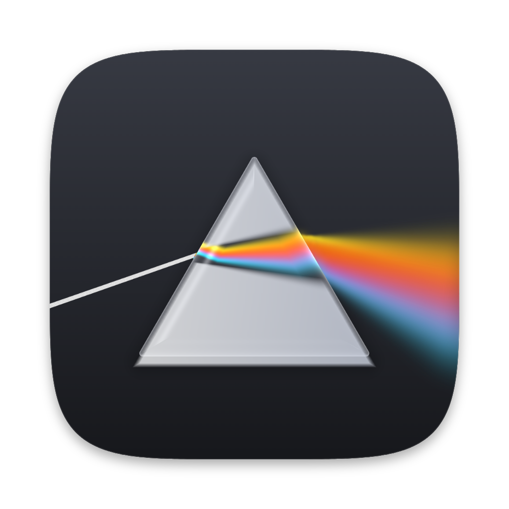
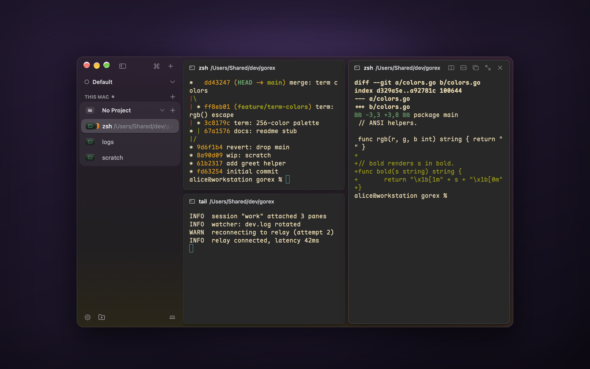

<p align="center">

</p>
<h1 align="center">GoRex Terminal</h1>

> Shells that keep running, on every machine you own.

[](https://github.com/si-mods/gorex/actions/workflows/ci.yml?query=branch%3Amain)

## Introduction

GoRex is a terminal for macOS, Linux and Windows — a replica of
[Superlogical's Rex](https://www.superlogical.com/updates/public-testing-beginning),
written in Go with [MyGo](https://mygo.egoist.dev)'s native UI and its
terminal plugin (Ghostty's libghostty-vt). No cgo: one ~15 MB app, whose
browser panes use the system's web view.

Shells run in a background session server: quit GoRex and everything
keeps running, open it again and every tab, split and pane comes back as
it was. Machines you pair connect over WireGuard or Tailscale, and their
sessions open beside your own. Rex's own apps, the iPhone one among them,
connect to GoRex as they do to a Rex server, and a web client runs in a
browser.



[Documentation](#documentation) | [CLI reference](docs/REF-001-cli.md) | [Releases](https://github.com/si-mods/gorex/releases)

## Features

- **Tabs, splits and floating panes**, each a card with its program's
  icon, name and directory; drag to reorder, split or resize. Note panes
  (sticky Markdown notes) and browser panes (the system's web view) sit
  beside the terminals.
- **Persistent sessions.** The session server keeps each screen
  headlessly, so even full-screen programs (vim, lazygit, htop) come back
  exactly, and Kitty graphics too.
- **Remote hosts.** Pair machines over tailcat — WireGuard end to end,
  no account — or discover them over Tailscale. A host's tabs open beside
  your own, and teleport moves a pane's work, agent conversation
  included.
- **Projects and spaces.** A project is a folder on a host; its tabs
  live in that host's layout, so every client sees the same tabs. Spaces
  (Work, Life) group the projects.
- **Program activity.** Headers name the running program and its
  directory; dots mark output, finished work and bells, and a command
  finishing in the background posts a notification.
- **Agent skill and hooks.** `gorex skill setup` installs a `gorex`
  skill and a session-start hook for Claude Code, Codex, Devin,
  Antigravity CLI, OpenCode and Pi.
- **Command palette** (⇧⌘P) for every command and pane; find, links,
  any of Ghostty's themes or theme packs of its own, light and dark,
  English and 简体中文.

## Install and update

The signed installer for macOS and Linux is published with each release.

```sh
curl -fsSL https://github.com/si-mods/gorex/releases/latest/download/install.sh | sh
```

On Windows (10 1809 or later, x64 and ARM64), run the PowerShell installer
or download `gorex-setup-*-amd64.exe` / `gorex-setup-*-arm64.exe` from
[the latest release](https://github.com/si-mods/gorex/releases/latest):

```powershell
irm https://github.com/si-mods/gorex/releases/latest/download/install.ps1 | iex
```

On Linux, `gorex update` installs a signed update where GoRex runs from,
which the user running it must be able to write: the per-user install, or a
system install such as one under `/opt`. It hands an active local session
server over to the new version. After installing a newer build yourself,
`gorex server upgrade` performs the handoff on macOS and Linux; it refuses
a build whose modification time is not newer than the server's. On Windows
and macOS, use **Check for Updates** in the app. See
[the CLI reference](docs/REF-001-cli.md#commands).

## Documentation

| Doc | Topic |
|---|---|
| [REF-010](docs/REF-010-desktop-app.md) | The desktop app: panes, sessions, projects, shortcuts, Settings |
| [REF-011](docs/REF-011-ghostty-config.md) | The Ghostty configuration |
| [REF-012](docs/REF-012-remote-access.md) | Remote access: Tailscale, tailcat, remote hosts, teleport |
| [REF-013](docs/REF-013-rex-import.md) | Importing a Rex session |
| [REF-001](docs/REF-001-cli.md) | The `gorex` command line |
| [REF-005](docs/REF-005-rex-api.md) | Rex's apps on GoRex (the iPhone app among them) |
| [REF-006](docs/REF-006-session-server.md) | The session server's terminals |
| [REF-007](docs/REF-007-web-client.md) | The web client |
| [REF-014](docs/REF-014-develop.md) | Build, release and the code map |

## Develop

GoRex needs [Go](https://go.dev/dl/) 1.27+ and MyGo, whose CLI `go.mod`
pins as a tool:

```sh
go tool mygo dev     # GoRex Dev, rebuilt and restarted as the code changes
go test ./...        # the server, and the view without a window
go tool mygo build   # build/darwin-arm64/GoRex.app and a .dmg
```

Signing, the release workflow, the data directory and a map of the code:
[docs/REF-014-develop.md](docs/REF-014-develop.md).

## Credits

Icons: [Lucide](https://lucide.dev) (ISC) and
[Simple Icons](https://simpleicons.org) (CC0).
Font: [JetBrains Mono](https://www.jetbrains.com/lp/mono/) (OFL).
